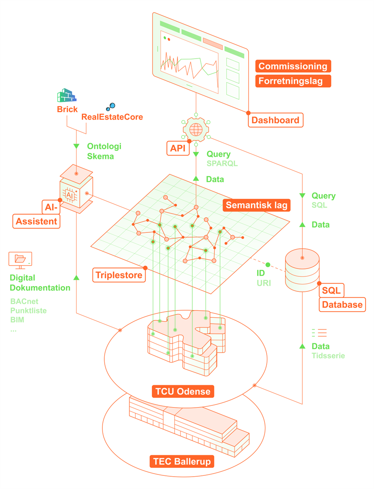
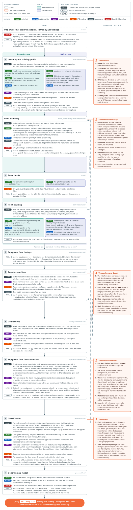
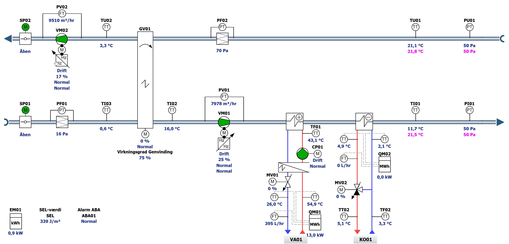

#dti-ai-cx-brick (repo in development)

*Project: AI-Cx — Proof-of-Concept: AI-assisteret og automatiseret semantisk integration af bygningsdata til commissioning og bygningsdrift*

This repository contains a proof-of-concept, human-in-the-loop agentic workflow. It maps a building's data and
documentation to a validated semantic data model (a model with standard names and relations) in the
[Brick ontology](https://brickschema.org/), to support use
cases such as continuous commissioning. The Danish Technological Institute (DTI) developed it as part of an
Energy Cluster Denmark project. The code, the agent instructions and this documentation were developed with
[Claude Code](https://claude.com/claude-code), Anthropic's AI coding tool, and reviewed by the project team.
They can contain errors. Check the results before you rely on them.

Discover the workflow steps in [The pipeline](#the-pipeline).

Each building management system (BMS) vendor and contractor names and structures data points differently, so the same sensor, zone or plant
(a technical installation, such as a ventilation unit or a heating system) can look different from one
building to the next. The workflow takes the data a building already has as input,
for example point lists, time-series object registries (lists of the stored time-series objects), BACnet exports, IFC models, contractor documentation and screenshots of the BMS. It maps this content into one semantic data model with standard names, using classes and
properties from the Brick and RealEstateCore ontologies. The semantic data model can then be used for commissioning, fault
detection, energy analytics and benchmarking across a building portfolio.

The AI agent, guided by its instruction files (skills), interprets the material: it decodes naming conventions
and abbreviations, and extracts equipment and system connections from the screenshots. Scripts that always
give the same result for the same input (deterministic tools) validate, classify and generate the semantic
data model.
A human confirms the agent's proposals at defined checkpoints. The result is one Turtle (`.ttl`) file per
building; Turtle is a text format for linked data. You can query the `.ttl` file directly with SPARQL, the
query language for linked data, for example with Apache Jena or Python's rdflib, or import it
into a graph database such as GraphDB.

Project design:



## Two data routes

The pipeline has two routes for the point data, one for each form it was built on: one building delivered a
BMS point list and a time-series database, the other a BACnet scrape (a read-out of all BACnet devices and their objects). A building uses one route. The agent
proposes it from your files, and you confirm it.

| | Timeseries route | BACnet route |
|---|---|---|
| Point data (TAGS) | A point-list CSV from the BMS | A device list and one object file per device |
| Ids (SQL IDS) | The registry of the time-series database: the list of its ids | The object names in the scrape |
| How a tag is formed | The plant column and the point column | The object name; rules in the building profile (the building's settings file) split it |
| Units | From the registry, as symbols (`°C`) | In the object files, as BACnet unit names (`degrees-celsius`) |
| Data link in the semantic data model | `ref:TimeseriesReference` | `ref:BACnetReference` |

Everything else is the same on both routes: the point dictionary (what each abbreviation and word in your tags
means), the zone-to-room links, the screenshots, the
classification and the semantic data model. Point data in another form needs a new route in the code and is out of scope.

The examples in this README use two invented buildings: `DEMO-TS` (timeseries route) and `DEMO-BN` (BACnet
route).

## Inputs

<table>
  <tr>
    <td align="center"></td>
    <td><b><a href="#input-tags">TAGS</a></b></td>
    <td align="center"></td>
    <td><b><a href="#input-sql-ids">SQL IDS</a></b></td>
  </tr>
  <tr>
    <td></td>
    <td valign="top">The point list: the tags of all BMS data points, each with its description. Timeseries route: a point-list CSV export. BACnet route: a BACnet device scrape.</td>
    <td></td>
    <td valign="top">The ids that link each point to its stored data: time-series ids in a database such as TimescaleDB, or the BACnet object names. The semantic data model uses them to point to the data of each point.</td>
  </tr>
  <tr>
    <td align="center"></td>
    <td><b><a href="#input-bms">BMS</a></b></td>
    <td align="center"></td>
    <td><b><a href="#input-bim">BIM</a></b></td>
  </tr>
  <tr>
    <td></td>
    <td valign="top">Screenshots of the BMS: plant and room overviews, floorplans, plant and room schematics. They show the equipment and which plant serves which zone.</td>
    <td></td>
    <td valign="top">The building information model (BIM) in IFC format. The architecture model gives the floors and rooms and is required. An installation model can cross-check which plant serves which room.</td>
  </tr>
  <tr>
    <td align="center"></td>
    <td><b><a href="#input-docs">DOCS</a></b></td>
    <td align="center"></td>
    <td><b><a href="#input-brick">BRICK</a></b></td>
  </tr>
  <tr>
    <td></td>
    <td valign="top">Any other information that helps to decode the tags in the point list, for example abbreviation legends, function descriptions and a zone matrix.</td>
    <td></td>
    <td valign="top">The Brick ontology, which includes the RealEstateCore (REC) ontology. It gives the standard classes and relations the semantic data model uses. The pipeline uses a nightly version of Brick 1.5.0 (Brick's development version).</td>
  </tr>
</table>

## The pipeline



## Input requirements

Each building has its own folder, `data/<buildingId>/`. You create it and choose its name; that name is the
building id.

<table>
  <tr>
    <td align="center"></td>
    <td><a id="input-tags" name="input-tags"></a><b>Input: TAGS</b></td>
  </tr>
  <tr><td>Used because:</td><td>It is the list of all data points. The pipeline decodes each tag and its description into Brick tags, and the Brick tags give the point its Brick class. The tag also shows which plant or zone the point belongs to.</td></tr>
  <tr><td>Formats</td><td><code>.csv</code>, UTF-8.</td></tr>
  <tr><td>Place in</td><td>Timeseries: <code>data/&lt;buildingId&gt;/inputs/&lt;buildingId&gt;_pointlist.csv</code>. BACnet: <code>data/&lt;buildingId&gt;/inputs/devices.csv</code> and the object files in <code>data/&lt;buildingId&gt;/inputs/objects/</code>.</td></tr>
  <tr><td>Required</td><td>Yes. Without it, the pipeline has no points to classify.</td></tr>
  <tr><td>Depends on</td><td>Two files the agent drafts with you. The building profile (<code>building-config.json</code>) records where your files are and how your tags split into plant or zone and point. The point dictionary (<code>point-dictionary.json</code>) lists every abbreviation and word in your tags and descriptions. Each entry has its meaning, the Brick tags it gives and the source of that meaning. On the timeseries route, SQL IDS supplies the units.</td></tr>
  <tr><td>Must contain</td><td>It depends on the route. You supply one of the two, not both. Timeseries: a point-list CSV with a plant, a point and a description column. BACnet: a device list and one object file per device. The details for each route follow below.</td></tr>
</table>

A *tag* is the full name of one data point in the BMS, for example `Z_101_TR1`: the point `TR1` in zone
`Z_101`. In Brick, each point gets one *class* that describes it, for example
`Supply_Hot_Water_Temperature_Sensor`. Brick also uses the word tag, for one of the words a class is made of:
that class has the tags *Supply*, *Hot*, *Water*, *Temperature*, *Sensor* and *Point*. This README calls
those *Brick tags*.

**Timeseries route: point-list CSV**

- A header row, then one row per point.
- A plant column and a point column are required. Together they give the tag: `Z_101` + `_` + `TR1` =
  `Z_101_TR1`.
- A good description column is strongly advised. The agent reads its words to decode the point.
- Zone ids must be easy to tell from plant ids, for example all zone ids start with `Z_`.
- Units are not needed here. They come from SQL IDS.

The examples use Danish BMS abbreviations. Plants: `VE` ventilation unit (*ventilationsanlæg*), `VA`
heating plant (*varmeanlæg*), `RAD` radiator circuit (*radiatorkreds*). `UC01` is a controller
(*undercentral*) and `Z_101` a zone. Points: `TR` room temperature (*temperatur rum*), `TI` supply air
temperature (*indblæsning*), `TF` supply water temperature (*fremløbstemperatur*), `SPI` supply air damper (*spjæld
indblæsning*), `MV` motorised valve (*motorventil*), `QM` heat meter and the suffix `SP` for a setpoint
(*setpunkt*). Abbreviations differ from building to building: the same letters can mean something else
elsewhere. The **point dictionary** records what they mean in your building.

**Example point list for timeseries** `DEMO-TS`:

```csv
Plant;Point;Description
Z_101;TR1;Temperatur rum
Z_101;TR1_SP;Setpunkt temperatur rum
Z_101_SPI1;POS;Spjæld indblæsning stilling
VE01;TI1;Temperatur indblæsning
VA07_QM1;FLOW;Flow varmemåler
```

The matching part of the profile:

```json
"pointListFormat": {
  "delimiter": ";",
  "columns": { "plant": "Plant", "point": "Point", "description": "Description" }
}
```

The same rows as the pipeline reads them. The tag joins the plant value and the point value with the
separator `_`:

| Plant | Point | Description | Tag | Zone or plant |
|---|---|---|---|---|
| `Z_101` | `TR1` | Temperatur rum | `Z_101_TR1` | zone `Z_101` |
| `Z_101` | `TR1_SP` | Setpunkt temperatur rum | `Z_101_TR1_SP` | zone `Z_101` |
| `Z_101_SPI1` | `POS` | Spjæld indblæsning stilling | `Z_101_SPI1_POS` | zone `Z_101` |
| `VE01` | `TI1` | Temperatur indblæsning | `VE01_TI1` | ventilation unit `VE01` |
| `VA07_QM1` | `FLOW` | Flow varmemåler | `VA07_QM1_FLOW` | heating plant `VA07` |

**BACnet route: device list and object files**

- A device list, `devices.csv`, with one row per device. It needs the device number (`instance`) and the
  device name (`object-name`).
- One object file per device, named `objects_<instance>_<any text>.csv`. It lists the device's objects with
  their type, number, name, description and unit (`object_type`, `object_instance`, `object-name`,
  `description`, `units`).
- The object name is the tag. It must show which plant or zone the object belongs to. The profile holds the
  rules that read the names. Objects that belong to no plant or zone are linked to the controller they are on.

**Example device list for BACnet** `DEMO-BN`:

```csv
instance,address,object-name,vendor-name,model-name
1001,10.0.0.11,UC01,Example Controls,DDC-1
```

**Example BACnet object file for controller** `UC01`:

```csv
object_type,object_instance,object-name,description,present-value,units,state-text
analog-input,1,DEMO_RAD01_TF1,Temperatur fremløb,45.2,degrees-celsius,
analog-output,2,DEMO_RAD01_MV1_POS,Motorventil stilling,35,percent,
analog-input,3,DEMO_Z_201_TR1,Temperatur rum,21.4,degrees-celsius,
schedule,1,DEMO_SCHEDULE,Ugeprogram,,,
```

What the pipeline reads from these tags. The agent finds the pattern in the tags and you confirm it:

| Tag (object name) | Belongs to | Point |
|---|---|---|
| `DEMO_RAD01_TF1` | radiator circuit `RAD01` | `TF1` supply water temperature |
| `DEMO_RAD01_MV1_POS` | radiator circuit `RAD01` | `MV1_POS` motorised valve position |
| `DEMO_Z_201_TR1` | zone `Z_201` | `TR1` room temperature |
| `DEMO_SCHEDULE` | the device itself, controller `UC01` (the tag names no plant or zone) | `SCHEDULE` week schedule |

Every tag in this building starts with the same site name, `DEMO_`. It tells nothing about the point, so the
semantic data model names the points without it, for example `RAD01_TF1`. The link to the data keeps the full tag.

<br>

<table>
  <tr>
    <td align="center"></td>
    <td><a id="input-sql-ids" name="input-sql-ids"></a><b>Input: SQL IDS</b></td>
  </tr>
  <tr><td>Used because:</td><td>The semantic data model links each point to its data with this id. Each id must belong to the right point, so that the data is linked to the correct point in the semantic data model.</td></tr>
  <tr><td>Formats</td><td>Timeseries: <code>.json</code>, UTF-8. BACnet: no separate file; the ids are the object names in the TAGS object files.</td></tr>
  <tr><td>Place in</td><td>Timeseries: <code>data/&lt;buildingId&gt;/inputs/objects.json</code>. BACnet: nothing to place.</td></tr>
  <tr><td>Required</td><td>Yes. The pipeline classifies a point without an id, but the semantic data model cannot point to its data.</td></tr>
  <tr><td>Depends on</td><td>TAGS. Timeseries: each id must be equal to a tag from the point list. BACnet: the id is the object name, which is also the tag.</td></tr>
  <tr><td>Must contain</td><td>Timeseries: a top-level <code>objects</code> array; each object has <code>object_name</code> (the tag), <code>object_type</code>, <code>object_instance</code> and <code>units</code>. BACnet: the object name, type and number, already in the TAGS object files.</td></tr>
</table>

**Timeseries route:**

- A point without an id gets no link to data. Setpoints and parameters often have no stored series.
- An id without a point-list row is listed as unmatched.
- The units come from this file. Symbols such as `°C` or `m³/h` need an entry in the point dictionary.

**Example id list for** `DEMO-TS`:

```json
{
  "objects": [
    { "object_name": "Z_101_TR1", "object_type": "AnalogInput", "object_instance": 101, "units": "°C" },
    { "object_name": "VE01_TI1", "object_type": "AnalogInput", "object_instance": 1, "units": "°C" },
    { "object_name": "VA07_QM1_FLOW", "object_type": "AnalogInput", "object_instance": 7, "units": "m³/h" }
  ]
}
```

BACnet route: the tag and the id are the same, the object name. In the TAGS example, `DEMO_RAD01_TF1` links
the point `RAD01_TF1` to its data.

<br>

<table>
  <tr>
    <td align="center"></td>
    <td><a id="input-bms" name="input-bms"></a><b>Input: BMS</b></td>
  </tr>
  <tr><td>Used because:</td><td>The tags show most of the equipment: each device with its own points, such as a pump or a valve. They do not show how the systems connect. The screenshots show which plant serves which zone and which plant serves which other plant. They also show where each item sits in the ducts and pipes (for example on the supply or the return side), and equipment that has no points.</td></tr>
  <tr><td>Formats</td><td><code>.png</code>, <code>.jpg</code>, <code>.jpeg</code>. Full-size screenshots.</td></tr>
  <tr><td>Place in</td><td><code>data/&lt;buildingId&gt;/images/</code>, one folder per kind of screen, for example <code>plants_overview/</code>, <code>rooms_overview/</code>, <code>floorplans/</code>, <code>plants/</code>, <code>rooms/</code>. Other folder names also work: the agent writes each folder's path into the building profile.</td></tr>
  <tr><td>Required</td><td>No, but strongly advised. Without screenshots, the equipment comes from the tags only, and the semantic data model has no "plant serves zone" relations. A point's supply or return side then comes from its tag and description only.</td></tr>
  <tr><td>Depends on</td><td>TAGS. The pipeline checks the plant and zone names on the screens against the tags.</td></tr>
  <tr><td>Must contain</td><td>One screen per image, at full size. The labels must be readable when the image is zoomed in. The kinds of screen are listed below; use the kinds your BMS has.</td></tr>
</table>

In the BMS, a zone is the area that the control system regulates as one, with its own
sensors and setpoints, for example `Z_101`. A room is a physical space in the architecture model (BIM), for example room
`1.01`. Often one zone is one room, but a zone can cover several rooms. The semantic data model keeps them apart, as
RealEstateCore does: the zone is an HVAC zone (`rec:HVACZone`, a zone defined to support a technology or use)
and the room is a room (`rec:Room`, part of the architecture). The zone's points, its equipment and the plant
that serves it connect to the zone. The semantic data model links the zone to each room it covers (`brick:hasLocation`).

**Kinds of screen images and example**

BMS screens differ from building to building. These are the kinds the pipeline reads, as seen in the two
buildings it was built on:

| Screen | What it shows | What the pipeline takes |
|---|---|---|
| Plant overviews | The plants, often one tab or table per system type, sometimes with live values. | Which plants exist and which belong together. |
| Room overviews | The zones, often one tab per floor, with zone name and, if present, room number and use. | Links from zones to rooms, and zone names. |
| Floorplans | The zones coloured by the plant that serves them, plant buttons in the same colours, the floor. | Which plant serves which zone. Not used without plant colours. |
| Plant schematics | One plant: title, labelled equipment, ducts or pipes with flow arrows, live values, connected plants. | Equipment and its position, read from where each item sits relative to the heat-recovery unit (ventilation) or the exchanger, meter or pump and valve (water). |
| Room schematics | One zone or room: header, labelled dampers, valves and sensors, a button naming the serving plant. | Zone equipment, and which plant serves the zone when floorplans have no colours. |
| Symbol legend | What each symbol means, if the BMS has such a screen. | Help to identify symbols without a label. It has no folder of its own; put it with the plant schematics. |

A symbol without a label gets no equipment item from the image, because an id is never made up. If that
equipment has points, its item comes from the tags; if not, it is only noted in the building's notes.

Example plant schematic of ventilation unit `VE01`:



<br>

<table>
  <tr>
    <td align="center"></td>
    <td><a id="input-bim" name="input-bim"></a><b>Input: BIM</b></td>
  </tr>
  <tr><td>Used because:</td><td>The architecture model gives the floors and rooms of the building. The pipeline links each BMS zone to its rooms. An installation model, for example the ventilation model, can check which plant serves which room.</td></tr>
  <tr><td>Formats</td><td><code>.ifc</code></td></tr>
  <tr><td>Place in</td><td><code>data/&lt;buildingId&gt;/inputs/</code></td></tr>
  <tr><td>Required</td><td>The architecture model: yes. Without it, the pipeline makes no semantic data model. An installation model: no.</td></tr>
  <tr><td>Depends on</td><td>TAGS. The zones from tags are needed to link to rooms. The agent finds the rule from the zone tags to the room numbers, and you confirm it. A zone matrix (DOCS) and the room overviews (BMS) can confirm the links.</td></tr>
  <tr><td>Must contain</td><td>Architecture model: the storeys (<code>IfcBuildingStorey</code>) with name and elevation, and the rooms (<code>IfcSpace</code>) with the room number (<code>Name</code>) and the room name (<code>LongName</code>), each on its storey. Installation model: the systems (<code>IfcSystem</code>), with their parts placed in rooms with the same room numbers. The system names can differ from the plant tags; the agent drafts a rule that maps them, and you confirm it. Any system type counts: ventilation, heating, cooling or water. But the profile holds one rule, a single name pattern, and a system whose name it does not match is left out. If you add installation models with different naming schemes, the pattern must cover them all. A system links to a room only through its parts placed in that room.</td></tr>
</table>

The pipeline uses the IFC models the same way on both routes. The architecture model places room `1.01` on its
storey. The installation model groups a supply air valve into system `VE01 Indblæsning` and places it in its
own room `1.01`; the room number links the two models. Storeys that are not floors (for example a work plane)
and spaces that are not rooms are left out when the point dictionary marks them: a storey by its name, a space
by its category (an IFC property). The agent proposes these entries and you confirm them.

**IFC example**

An excerpt of the IFC files in IFC2X3 text format (the format of both buildings' models).

```
/* architecture model */
FILE_SCHEMA(('IFC2X3'));
#100=IFCBUILDINGSTOREY('2xY7kDqfL3QhXz9vN1pA0b',#2,'1. sal',$,$,#101,$,$,.ELEMENT.,3600.);
#200=IFCSPACE('0aB4cD6eF8gH0iJ2kL4mN6',#2,'1.01',$,$,#201,$,'Kontor',.ELEMENT.,.INTERNAL.,$);
#210=IFCRELAGGREGATES('1pQ3rS5tU7vW9xY1zA3bC5',#2,$,$,#100,(#200));

/* installation model */
FILE_SCHEMA(('IFC2X3'));
#300=IFCSYSTEM('3dE5fG7hI9jK1lM3nO5pQ7',#2,'VE01 Indbl\X\E6sning',$,'VENTILATION, INDBL\X\C6SNING');
#350=IFCSPACE('2hI4jK6lM8nO0pQ2rS4tU6',#2,'1.01',$,$,#351,$,'Kontor',.ELEMENT.,.INTERNAL.,$);
#400=IFCFLOWTERMINAL('2rS4tU6vW8xY0zA2bC4dE6',#2,'Indbl\X\E6sningsventil',$,$,#401,$,$);
#410=IFCRELASSIGNSTOGROUP('0fG2hI4jK6lM8nO0pQ2rS4',#2,$,$,(#400),$,#300);
#420=IFCRELCONTAINEDINSPATIALSTRUCTURE('1tU3vW5xY7zA9bC1dE3fG5',#2,$,$,(#400),#350);
```

What the pipeline reads from these lines:

| Model | IFC entity | Field | Example value | Used for |
|---|---|---|---|---|
| Architecture | `IfcBuildingStorey` | `Name` | 1. sal | the floor name |
| Architecture | `IfcBuildingStorey` | `Elevation` | 3600 | the floor number: storeys are numbered by height, the storey at 0 is floor 0 |
| Architecture | `IfcSpace` | `Name` | 1.01 | the room number; a rule links zone `Z_101` to room `1.01` |
| Architecture | `IfcSpace` | `LongName` | Kontor | the room name; the point dictionary turns it into a room type (office) |
| Installation | `IfcSystem` | `Name` | VE01 Indblæsning | a rule maps it to the plant tag `VE01`; that plant serves the rooms the system's parts are in |

<br>

<table>
  <tr>
    <td align="center"></td>
    <td><a id="input-docs" name="input-docs"></a><b>Input: DOCS</b></td>
  </tr>
  <tr><td>Used because:</td><td>The agent uses these documents to write the point dictionary: the meaning of each abbreviation in the tags, with a quote from the source. A zone matrix helps to link zones to rooms.</td></tr>
  <tr><td>Formats</td><td><code>.pdf</code> with selectable text, <code>.csv</code>. Convert <code>.docx</code> and <code>.xlsx</code> to PDF or CSV first; the tools cannot read them.</td></tr>
  <tr><td>Place in</td><td><code>data/&lt;buildingId&gt;/docs-unsorted/</code></td></tr>
  <tr><td>Required</td><td>No. Without documents, the agent decodes the tags from the descriptions in the point list and asks you more questions.</td></tr>
  <tr><td>Depends on</td><td>TAGS: an abbreviation gets a meaning only if it occurs in the tags.</td></tr>
  <tr><td>Must contain</td><td>Abbreviation legends: one row per abbreviation, with its meaning. PDF files: selectable text; the agent cannot quote a scanned page without it.</td></tr>
</table>

Documents can be wrong or out of date. The agent checks each meaning against the descriptions in the point list
and shows you every conflict.

Example abbreviation legend:

```csv
Forkortelse;Betydning
VE;Ventilationsanlæg
VA;Varmeanlæg
RAD;Radiatorkreds
TR;Temperatur rum
TI;Temperatur indblæsning
TF;Temperatur fremløb
SPI;Spjæld indblæsning
MV;Motorventil
```

<br>

<table>
  <tr>
    <td align="center"></td>
    <td><a id="input-brick" name="input-brick"></a><b>Input: BRICK</b></td>
  </tr>
  <tr><td>Used because:</td><td>Each Brick class is defined by a set of Brick tags. The pipeline gives each point the class whose tags match the point's Brick tags: <i>Supply</i>, <i>Hot</i>, <i>Water</i>, <i>Temperature</i> and <i>Sensor</i> give <code>Supply_Hot_Water_Temperature_Sensor</code>. The relations in the semantic data model are Brick and RealEstateCore properties, for example <code>brick:hasPoint</code> (equipment or zone to its point), <code>brick:feeds</code> (plant to the zone or plant it serves), <code>brick:hasPart</code> (plant to its equipment), <code>brick:hasLocation</code> (zone to room), <code>rec:isPartOf</code> (room to floor) and <code>ref:hasExternalReference</code> (point to its data link).</td></tr>
  <tr><td>Formats</td><td><code>.ttl</code> (the ontology) and <code>.json</code> (two index files made from it).</td></tr>
  <tr><td>Place in</td><td><code>ontologies/</code>. It is provided in this repository.</td></tr>
  <tr><td>Required</td><td>Yes. It is provided, so you supply nothing.</td></tr>
  <tr><td>Depends on</td><td>Nothing.</td></tr>
  <tr><td>Must contain</td><td>Nothing to prepare.</td></tr>
</table>

The tools do not read the full ontology. They read two index files made from it:
`brick-classification-index.json` (each class with its Brick tags) and `brick-relationship-index.json` (the
relations). To use a newer version, you make the two index files again; see
[Prerequisites and setup](#prerequisites-and-setup).

Example entry in the class index:

```json
"brick:Supply_Hot_Water_Temperature_Sensor": {
  "label": "Supply Hot Water Temperature Sensor",
  "parent": "brick:Water_Temperature_Sensor",
  "tags": ["Hot", "Point", "Sensor", "Supply", "Temperature", "Water"]
}
```

How the semantic data model uses Brick:

- **Systems include, equipment has parts.** A plant whose class is a system (for example
  `Hot_Water_System`) links to its equipment with `rec:includes`. A plant whose class is equipment (for
  example `Air_Handling_Unit`) uses `brick:hasPart`.
- **Points never sit on a system.** A point of a system plant is linked to the equipment it belongs to, or to
  a controller in the semantic data model (`brick:Controller`, `brick:hosts`) when no equipment owns it.
- **Sub-plants:** a plant that belongs to another plant, for example a fire-damper group under its ventilation
  unit, is linked with `brick:isPartOf`.
- **Zones and rooms:** zones are `rec:HVACZone`, rooms are `rec:Room` or a more specific room class, floors are
  `rec:Level`. A room is `rec:isPartOf` its floor, a floor is `rec:isPartOf` the building. Zone equipment
  (for example a VAV damper) `brick:feeds` its zone.
- **Data links:** on the timeseries route each point gets a `ref:TimeseriesReference` with its time-series id.
  On the BACnet route it gets a `ref:BACnetReference` with the object name, object type and number, and the
  device it is on.
- **Supply and return water:** a loop's own pump or valve gives `Supply_` or `Return_` classes. A heat exchanger
  or a meter, at the boundary between two circuits, gives `Leaving_` or `Entering_` classes.
- **Brick tags and units:** every point also keeps all its Brick tags (`brick:hasTag`), also the ones no class
  holds. Units are QUDT units, a standard list of unit names (`brick:hasUnit unit:DEG_C`).
- **No deprecated classes:** the semantic data model uses only classes that are not deprecated in the Brick nightly version;
  validation fails on a deprecated class.

## Files the agent creates with you

A building's folder after a run:

```
data/<buildingId>/
├── building-config.json    the building profile
├── point-dictionary.json   the point dictionary
├── zone-rooms.json         the zone-to-room rule and your decisions
├── notes/                  the screen guide and notes on the screenshots
├── inputs/                 your point data and IFC models, and the files the tools make from them
├── images/                 your screenshots
├── docs-unsorted/          your documents
└── outputs/building.ttl    the semantic data model
```

The agent drafts four kinds of file with you, and you confirm what is in them. It saves the profile, the
dictionary and the zone-to-room file with the tools, which check them first. It writes the notes as plain text.

| File | What it holds |
|---|---|
| `building-config.json` | Your building's settings: which route it uses, where each input file is, and the rules that split a tag into its plant or zone part and its point part. With screenshots, also where the screen guide is and which screens show which plant serves which zone. Optional rules say how installation-IFC system names map to plants, and which mark in an equipment id shows the air side. |
| `point-dictionary.json` | What each abbreviation, word, ending (such as `_SP`) and unit symbol in your tags and descriptions means, which Brick tags it gives, and where that meaning comes from: a quote from a document, rows of the point list, or your answer. It also holds the plant abbreviations, which abbreviations stand for equipment, room-name words that give the room type, floors and spaces to leave out, and corrections for single points. The agent builds it as a draft (`point-dictionary.draft.json`). When nothing is open and the draft passes its checks, the `promote` command of `write-point-dictionary-entry.ts` turns it into the dictionary. |
| `zone-rooms.json` | The rule that turns a zone name into room numbers (for example `Z_101` → room `1.01`). Also what the other sources say (zone matrix, room overviews, the headers of the room schematics, which plant serves which zone), whether they agree with the rule, and your answer for each zone they don't settle. |
| `notes/*.md` | Plain text. The screen guide (`notes/bms-screens.md`) says where this BMS shows each kind of information, for example where the header and the plant button sit on a room schematic. Other notes record problems found while reading the screenshots, and equipment with no label on screen, which therefore gets no item. |

The tools also save their results in `inputs/`:

- `plant-point-mapping.json` and `zone-point-mapping.json`: the points
- `ifc-spatial.json` and `spatial-hierarchy.json`: floors, rooms and zones
- `building-connections.json`: which plant serves which zone or plant
- `equipment-inventory.json`: the equipment
- on the timeseries route, also the point list split into plant rows and zone rows

The semantic data model goes to `outputs/building.ttl`. Don't edit these files by hand; change them through
the tools.

## Repository contents

**Agent instructions**

| File | What it does |
|---|---|
| `CLAUDE.md` | The rules the agent follows in every session. |
| `.claude/skills/skill-00-context.md` | Shared terms, the data layout and the pipeline steps with their tools. |
| `.claude/skills/point-mapping/SKILL.md` | Building profile, point dictionary, point mapping, zone-to-room links. |
| `.claude/skills/building-connections/SKILL.md` | Which plant serves which zone or plant, from the screenshots. |
| `.claude/skills/equipment-inventory/SKILL.md` | Equipment from the tags and the screenshots. |
| `.claude/skills/brick-assign/SKILL.md` | Brick classes and the review of uncertain points. |
| `.claude/skills/brick-relationships/SKILL.md` | The relations the semantic data model uses. |
| `.claude/skills/generate-ttl/SKILL.md` | Making and checking the semantic data model. |

**Building profile and point dictionary**

| File | Usage | What it does |
|---|---|---|
| `tools/write-building-profile.ts` | `echo '<profile json>' \| npx ts-node tools/write-building-profile.ts <buildingId> [--force]` | Checks the profile and tries its rules on your point data, then saves it. A problem stops the save; a warning does not. `--validate` checks a saved profile again. |
| `tools/pipeline-status.ts` | `npx ts-node tools/pipeline-status.ts <buildingId>` | Shows which steps apply and which are done. |
| `tools/write-point-dictionary-entry.ts` | `npx ts-node tools/write-point-dictionary-entry.ts init\|set\|set-batch\|status\|account\|remove\|promote <buildingId> ...` | The only way to change the point dictionary. You and the agent work on a draft: `init` starts it, `set` and `set-batch` add or change entries, `status` confirms them, `account` notes how each legend row, dropped entry and unused word was handled, and `remove` deletes an entry. `promote` checks the draft and turns it into `point-dictionary.json`. `--validate` checks the dictionary. |
| `tools/review-dictionary-draft.ts` | `npx ts-node tools/review-dictionary-draft.ts <buildingId> [--check-only] [--equipment <inputsDir>] [--word-min <n>]` | Lists what in the draft still needs your answer. First come the items to decide one by one (for example a document that disagrees with the point list), then the open notes and legend rows, then the entries found only in the point list, which you confirm as one table. It also lists frequent words with no entry, and points the dictionary does not yet explain. |
| `tools/search-supporting-docs.ts` | `npx ts-node tools/search-supporting-docs.ts <buildingId> <query>` | Searches the building's documents (CSV, JSON, and PDF with selectable text) for an abbreviation or word. It returns short quotes with the file and line or row, and says so when a PDF is a scan without text or a file type can't be read. |
| `tools/export-dictionary-review.ts` | `npx ts-node tools/export-dictionary-review.ts <out.json\|out.html> <buildingId>` | Exports the draft for review, as data or as a page (with `tools/review-page/`). |

**Point mapping and zone-to-room links**

| File | Usage | What it does |
|---|---|---|
| `tools/map-points.ts` | `npx ts-node tools/map-points.ts <buildingId> [--force]` | Maps the points by the route. Timeseries: runs `split-pointlist-csv`, `map-plant-points` and `map-zone-points`. BACnet: runs `map-bacnet-points`. |
| `tools/split-pointlist-csv.ts` | `npx ts-node tools/split-pointlist-csv.ts <buildingId>` | Timeseries: splits the point list into plant rows and zone rows. |
| `tools/map-plant-points.ts`, `tools/map-zone-points.ts` | `npx ts-node tools/map-plant-points.ts <buildingId> [--force]` | Timeseries: links each plant row and zone row of the point list to its id in the time-series database, and saves the result in `plant-point-mapping.json` and `zone-point-mapping.json`. |
| `tools/map-bacnet-points.ts` | `npx ts-node tools/map-bacnet-points.ts <buildingId> [--force]` | BACnet: puts each object on its plant, zone or controller, using the building profile's rules for object names, and saves the result in the same two files. |
| `tools/build-spatial-hierarchy.py` | `python tools/build-spatial-hierarchy.py --building <buildingId>` | Reads the floors and rooms from the architecture IFC, and which plant serves which room from the installation IFCs, and saves them in `inputs/ifc-spatial.json`. It keeps everything; the zone-to-room step leaves out what is not a floor or room. |
| `tools/write-zone-rooms.ts` | `echo '<json>' \| npx ts-node tools/write-zone-rooms.ts <buildingId> rule\|sources\|checks\|decisions` | The only way to change the zone-to-room file. `rule` sets the rule from zone names to room numbers, `sources` and `checks` add what other sources say and whether they agree, and `decisions` adds your answer for a zone. It saves only if the file passes its checks. |
| `tools/match-zone-rooms.ts` | `npx ts-node tools/match-zone-rooms.ts <buildingId> [--review] [--force]` | Links each zone to its rooms with the rule you confirmed, compares the result with the other sources, and saves it in `inputs/spatial-hierarchy.json`. `--review` lists what needs your answer. |

**Screenshots, connections and equipment**

| File | Usage | What it does |
|---|---|---|
| `tools/crop-image.py` | `python tools/crop-image.py <image> --region NAME=x0,y0,x1,y1 --scale 3` | Crops and enlarges part of a screenshot so the labels can be read. The region is given as fractions (0 to 1) of the image width and height. `--skeleton` crops a strip across the whole width. |
| `tools/update-connections.ts` | `echo '<json>' \| npx ts-node tools/update-connections.ts <buildingId> --type feeds\|serves\|hierarchy` | Writes which plant serves which zone or plant, and saves it in `inputs/building-connections.json`. `--validate` and `--summary` check it. |
| `tools/reconcile-feeds-ifc.py` | `python tools/reconcile-feeds-ifc.py <buildingId> <installation_ifc_path>` | Compares the screenshot result with the installation model. |
| `tools/update-equipment.ts` | `npx ts-node tools/update-equipment.ts <buildingId> --bms` | Writes the equipment from the tags, and saves it in `inputs/equipment-inventory.json`. `--type zone\|plant` writes equipment from a screenshot, `--type zone-meta` zone names from a room overview (JSON piped in with `echo`). |
| `tools/validate-ductpath.ts` | `npx ts-node tools/validate-ductpath.ts <buildingId>` | Checks each equipment item's supply or extract side against its id, when the building's ids mark the air side (for example `I` for *indblæsning* in `VI1`, `U` for *udsugning* in `VU1`) and the profile has a rule for it. |
| `tools/run-equipment-extraction.ts` | `npx ts-node tools/run-equipment-extraction.ts <buildingId> --stage rooms\|plants\|all` | Optional: reads many screenshots without a person present, through the `claude` command. The checks with you follow afterwards. |
| `tools/audit-classes.ts` | `npx ts-node tools/audit-classes.ts <buildingId>` | Optional advice on classes and on what each piece of equipment carries (air or water). |

**Classification and review**

| File | Usage | What it does |
|---|---|---|
| `tools/classify-all.ts` | `npx ts-node tools/classify-all.ts <buildingId> [--dry-run] [--only plants\|equipment\|spatial\|zones\|points]` | Gives every point, plant, piece of equipment, zone, floor and room a Brick class, and saves it in the point mapping, equipment and floor-and-room files. Anything you have reviewed keeps its class. `--dry-run` shows the result without saving. |
| `tools/group-low-confidence.ts` | `npx ts-node tools/group-low-confidence.ts <buildingId>` | Groups the points the pipeline is unsure about by how they were decided, with examples, so you can review a whole group at once. It changes nothing. |
| `tools/assign-brick.ts` | `npx ts-node tools/assign-brick.ts <buildingId> --type <type> ...` | Sets the class of one item, or a list of items, after your review. The item is marked as reviewed, so `classify-all.ts` does not change it later. |
| `tools/compare-classes-by-cause.ts` | `npx ts-node tools/compare-classes-by-cause.ts <buildingId> --before <inputsDir> --after <inputsDir> [--out <file.md>]` | After a change, groups the class changes by their cause. `--out` also writes the file of groups that `apply-class-verdicts.ts` reads. |
| `tools/apply-class-verdicts.ts` | `npx ts-node tools/apply-class-verdicts.ts <buildingId> --groups <file.json> --verdicts <file.json>` | Applies your decision per group to reviewed points. |
| `tools/diff-pointclass.ts` | `npx ts-node tools/diff-pointclass.ts <fileA> <fileB>` | Shows the class changes between two mapping files. |

**Model and checks**

| File | Usage | What it does |
|---|---|---|
| `tools/generate-ttl.ts` | `npx ts-node tools/generate-ttl.ts <buildingId>` | Makes `outputs/building.ttl`. |
| `tools/validate-ttl.ts` | `npx ts-node tools/validate-ttl.ts <buildingId>` | Checks the semantic data model: Turtle syntax, classes, relations. |
| `tools/validate-refs.ts` | `npx ts-node tools/validate-refs.ts <buildingId>` | Checks that every point in the semantic data model links to a real id in your input files, and that no id is missing or extra. On BACnet it also checks the object and its device. |

**Brick, shared code and setup**

| File | What it does |
|---|---|
| `ontologies/Brick_nightly.ttl` | The Brick ontology the pipeline uses. |
| `ontologies/brick-classification-index.json` | Each Brick class with its Brick tags. Made from the ontology. |
| `ontologies/brick-relationship-index.json` | The Brick relations. Made from the ontology. The agent reads it through the skills. |
| `tools/build-brick-classification-index.ts`, `tools/build-brick-relationship-index.ts` | Make the two index files again; see [Prerequisites and setup](#prerequisites-and-setup). |
| `tools/lib/` | Code the tools share. |
| `package.json`, `package-lock.json`, `tsconfig.json` | Node packages and TypeScript settings. |
| `docs/icons/`, `docs/examples/` | The icons and the example image in this README. |

## Prerequisites and setup

- [Claude Code](https://claude.com/claude-code), to run the agent. It reads `CLAUDE.md` and the skills.
- Node.js with npm. Install the packages in the repository folder:

  ```bash
  npm install
  ```

- Python 3.10 or later with `ifcopenshell` (IFC models) and Pillow (screenshot crops):

  ```bash
  pip install ifcopenshell pillow
  ```

- `pdftotext` from Poppler on the PATH, to read PDF documents.
- On Windows, use Git Bash for the commands that pass JSON with `echo ... |`. Windows PowerShell 5.1 changes
  `æ`, `ø` and `å` on the way.
- Optional: the `claude` command on the PATH for `run-equipment-extraction.ts`.

**Brick version and updating.** The repository provides a nightly version of Brick 1.5.0
(`ontologies/Brick_nightly.ttl`, added on 2026-08-17) and the two index files made from it. No tool reads the
ontology file while it runs: the tools read the classification index, and the agent reads the relationship index
through the skills. To use a newer nightly version, replace the file and make the index files again:

```bash
npx ts-node tools/build-brick-classification-index.ts ontologies/Brick_nightly.ttl ontologies/brick-classification-index.json
npx ts-node tools/build-brick-relationship-index.ts ontologies/Brick_nightly.ttl ontologies/brick-relationship-index.json
```

A newer version can change the classes your points get, and some steps can fail. A Brick tag that is gone makes
the point dictionary fail its check; a class that is gone or deprecated makes the semantic data model fail validation. The
index files are shared by all buildings, so check the change before you keep it:

1. Copy a classified building's `inputs/` folder, and keep a copy of the two index files.
2. Make the new index files and classify the building again.
3. Compare the classes, then validate the semantic data model:

   ```bash
   npx ts-node tools/compare-classes-by-cause.ts <buildingId> --before <copy> --after data/<buildingId>/inputs
   ```

4. If the result is worse, put the old index files back.

The index tools have been tested only on the version provided.

## How to start

1. Create the building folder `data/<buildingId>/` and put your inputs in it (see [Input requirements](#input-requirements)).
2. Open Claude Code in the repository folder.
3. Ask: *Show me the current progress for `<buildingId>`*. The agent runs `pipeline-status.ts`. For a new
   building it reports that the building profile is missing, and the first step is the inventory: the agent
   looks at your files and drafts the profile with you.
4. Go on step by step. The agent stops when it needs your answer. Later requests are, for example, *Classify all
   entities for `<buildingId>`* and *Generate TTL for `<buildingId>`*.

## Limits

- The pipeline was built and tested on two buildings, one per route. For another building, the agent writes
  new rules in the building profile (how tags split, how zone ids look, how BACnet object names are read) and
  a new point dictionary. Naming that these rules cannot express, and point data in another form, need
  changes in the code.
- The instructions for reading screenshots assume Danish screen text: they warn about misreading ø, æ and å.
  Screens in another language get no such guidance.
- Without an architecture model (IFC) the pipeline makes no semantic data model: the zone-to-room step needs
  its floors and rooms. Rooms the IFC lacks can be added from documents by your decision, but they cannot
  replace it.
- The building profile has one rule that maps installation-IFC system names to plants. Systems whose names it
  does not match are left out, so installation models with different naming schemes need one pattern that
  covers them all.
- For water points of a plant, the supply or return side comes from the screenshots: the side of the linked
  pump, valve or exchanger. When no screenshot gives it, the pipeline looks for fixed words in the point's
  description and meaning text (`fremløb`, `frem` or `supply`; `returløb`, `retur` or `return`). These words
  are in the code, not in the point dictionary, so this step works only for Danish or English text. The
  pipeline marks every such point for your review, also when the point dictionary already settles its side.
- The validation is the pipeline's own: Turtle syntax, classes, relations and data links, plus a few rules
  taken from the SHACL shapes in the Brick ontology. SHACL is the W3C standard for rules on linked data. The
  pipeline does not run a SHACL validator (for example pySHACL), so it does not check all of Brick's SHACL
  rules, nor other rule sets.
- `audit-classes.ts` (optional) finds points whose class may be too general and equipment whose medium may be
  wrong. It uses fixed Danish and English words in its code, not the point dictionary, so use its result as
  advice only.
- On the BACnet route, `assign-brick.ts` cannot set the class of a point on a controller (not on a plant or
  zone): it has no type for such points. Change it through the point dictionary, or, for a point already reviewed, through a group
  verdict with `apply-class-verdicts.ts`.

## Licence and credits

- **This repository:** *licence to be added.*
- **Brick** (`ontologies/Brick_nightly.ttl` and the two index files made from it): BSD 3-Clause License,
  Copyright (c) 2016-2026, Brick Consortium, Inc. See [BrickSchema/Brick](https://github.com/BrickSchema/Brick).
- **RealEstateCore** (part of the Brick nightly version): BSD 3-Clause License, Copyright (c) 2022, RealEstateCore
  Consortium. See [RealEstateCore/rec](https://github.com/RealEstateCore/rec). If you use REC in research, its
  authors ask you to cite: Hammar, K., Wallin, E. O., Karlberg, P., Hälleberg, D. (2019). *The RealEstateCore
  Ontology*. ISWC 2019. https://doi.org/10.1007/978-3-030-30796-7_9
- **QUDT** (the unit identifiers in the semantic data model): Creative Commons Attribution 4.0 International (CC BY 4.0).
  See [qudt.org](https://www.qudt.org/).
- Developed by the Danish Technological Institute (DTI) as part of an Energy Cluster Denmark project.
