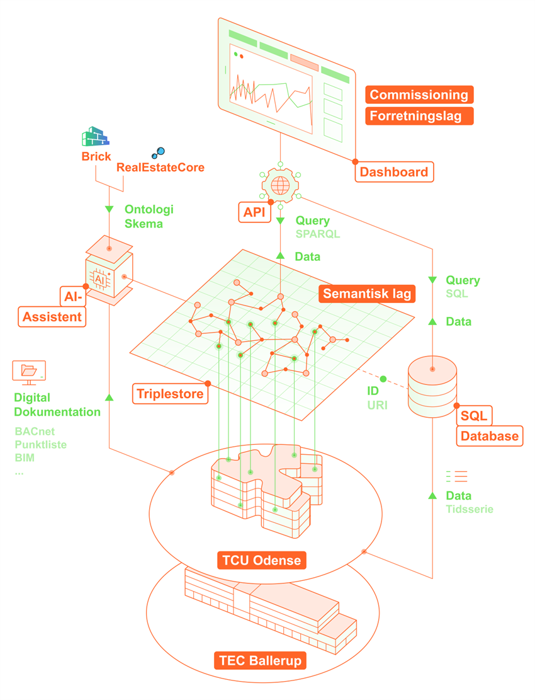

# dti-ai-cx-brick (repo in development)
### Project: AI-Cx — Proof-of-Concept: AI-assisteret og automatiseret semantisk integration af bygningsdata til commissioning og bygningsdrift

This repository contains a proof of concept human-in-the-loop agentic workflow that maps building data and information to a validated semantic [Brick Ontology](https://brickschema.org/) model to support continuous commissioning. Developed by the Danish Technological Institute (DTI) as part of an Energy Cluster Denmark project.

Discover the workflow steps here: ??

Each BMS vendor and contractor names and structures data points differently, so the same sensor, zone or plant may appear different from building to building. The workflow takes the available data a building already has as inputs, in example: point lists, time-series objects, BACnet exports, contractor documentation and screenshots of the BMS i.e. zones and plants. It leverages the contents and translates these into a data model with standardized naming using classes and properties from ontologies (Brick and RealEstateCore) that can subsequently be used for commissioning, fault detection, energy analytics, benchmarking and more across a building portfolio. AI agent skills interpret the material: they decode naming conventions and abbreviations, and extract equipment and system connections from the screenshots. Deterministic tools validate, classify and generate the model and a person confirms the AI’s proposals at defined checkpoints.

